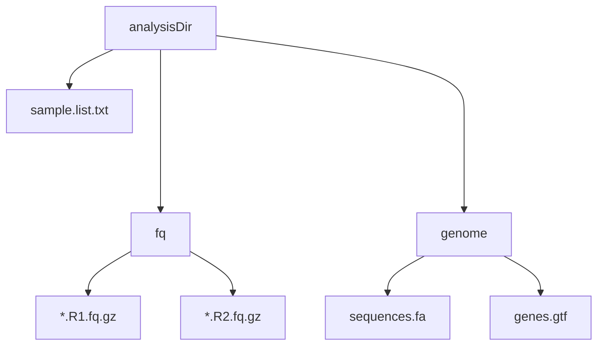

### 功能

- 从Clean reads 到变异 VCF 的一键分析
- 支持多个样本分析
- 默认并行计算
- 所有分析命令保存在文件中

### 注意事项

- 没有FastQ的QC步骤，请确保使用 Clean reads 作为输入
- 建议使用大内存服务器

### 输入文件目录准备




### 依赖
使用 conda 安装依赖：
```bash
mamba create -n WGS perl=5.26.2 gatk4=4.2.5  bwa=0.7.17  samtools=1.15  snpeff=5.1 python=3.8 parallel=20211222 bcftools=1.15 multiqc=1.12
```

### 使用方法

#### 方法 1

```bash
# 激活环境
conda activate WGS
```
进入分析目录analysisDir，直接运行onekeyReseq。
>请确保onekeyReseq脚本和数据文件都存在。 

```bash
cd /mnt/d/workshop/analysisDir
bash onekeyReseq
```

#### 方法 2

```bash
# 激活环境
conda activate WGS
```
在任意目录运行onekeyReseq
>确保数据文件在工作目录中

```bash
bash /path/to/onekeyReseq   /path/to/analysisDir
```

### 结果
|目录|含义|
|:-|:-|
|1.mapping|映射结果<br>mapStat.html 是分析报告|
|2.SNP|SNP/InDel 结果<br>2.SNP/4.anno/all.Variants.anno.vcf.gz 是最终的变异文件|
|commands|.sh 是详细命令 <br>.sh.ok 表示该步骤正常完成|
|log|日志文件<br>stdout.log 是标准输出日志，stderr.log 是标准错误日志|

